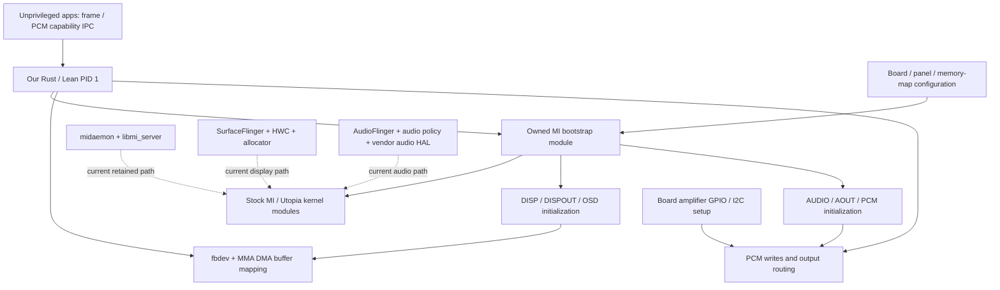

# Replacing midaemon on the original G06 / V109

The shortest plausible replacement is a small **Rust module owned by PID 1**
that initializes the required MI kernel subsystems and owns display/audio device
handles. It need not reproduce the vendor multimedia Binder services. It must
do more than write the MI readiness flag: the vendor wrapper performs a large
initialization sequence immediately before publishing that flag.

This is an offline reconstruction plus a read-only live snapshot supplied by
the hardware coordinator. No daemon was stopped, no device ioctl was issued by
this investigation, and the proposed minimum has **not** been tested cold.
The current Java-to-native client changes still retain the vendor services.

## Evidence and reproduction

Exact V109 files, not V122 or G13 references:

| File under `assets/research/firmware-implications/tvservice/` | SHA-256 |
| --- | --- |
| `bin/midaemon` | `43f6bb52b216f407674921b01fd10165551dcf6887e4eec1fb1728928e4aa3bf` |
| `glibc/libmi.so` | `08a850e63442245ed1534168465cffe9ff87686b696f292f9355fcd3f8096a58` |
| `glibc/libmi_server.so` | `8e01592e1917f8feb24f2c6a180d3c95aa83995c30dcd72ecc69b96bf980b948` |

`python3 tools/midaemon/inspect.py` records these hashes and annotated ARM
disassemblies in `assets/research/midaemon-replacement/`. String annotations
are a convenience heuristic, not control-flow emulation; use the underlying
instructions and relocations for conclusions. `libmi.so` also retains DWARF:
`assets/research/firmware-implications/libmi.dwarf.txt`.

The coordinator's `live-baseline.txt` and `live-threads-binder.txt` in that
directory show PID 526, PPID 1, root, 13,064 KiB RSS and seven threads. The
main thread was in a futex wait, one worker in epoll, two more in futex waits,
and three Binder workers in `binder_ioctl_write_read`. File descriptors cover
SYS/FLASH, most MI modules, MMA/Utopia, TEE and `/dev/binderfs/vndbinder`.
An open descriptor proves ownership, not that its subsystem is needed by Doom
or software-decoded video. Default `service list` listed seven Android services;
that is not an inventory of the separate vendor Binder domain. Binder debug
transaction state was unavailable in the snapshot.
The new read-only Rust probe subsequently ran successfully on hardware:
`live-mi-status.txt` records vendor result 0 / ready 1 for selectors
40, 1, 3, 6, 9, 10, 11, 17 and 23. This validates the nested SYS query ABI;
it does not prove any init or replacement sequence.

## What the vendor process actually does

The executable's `main` at `0x1c88` waits for the kernel module, reads platform
configuration/security material, initializes SYS, and starts an AUDIO init
thread. Its explicit top-level init calls include FLASH (`0x2c14`), DISP
(`0x2d08`), TUNER (`0x2d90`), DMX (`0x2e48`), OSD (`0x2f80`) and DSC
(`0x3008`). It records module-success bits. The `_init_thread` at `0x43a8`
initializes AUDIO and records selector 17. `main` waits for that bit before
calling `MI_SYS_SetAttr(5, {selector=1, ready=1})` at `0x30e0`.

That final library call is important. `libmi.so::MI_SYS_SetAttr` at `0xa4a30`
special-cases attribute 5 / selector 1. It reads the existing status; if the
ready byte is false it calls `_MI_WRAPPER_SYS_ModuleInit` (`0xa1c40`) before
issuing the SET ioctl. The wrapper attempts the following sequence, returning
early on a result other than 0 or 2:

```
WDT -> IIC -> GPIO -> FLASH -> DISP -> DISPOUT -> EXTIN -> TUNER -> DMX
 -> TSIO -> VIDEO -> VMON -> AUDIO -> AOUT -> AEXTIN -> PCM -> SYNC
 -> CAP -> VENC -> OSD -> IMGDEC -> INJECT -> CEC -> SAR -> PWM -> DSC
 -> CIPHER -> TSR -> NET -> TSMUX -> SOCKET -> SVP
```

This explains the broad live descriptor inventory. It also means an exact
replacement must decide which of these calls are needed, rather than assuming
the six obvious calls in `main` describe the whole bootstrap. Codes 0 and 2
are accepted by these wrappers; this report does not assign a general meaning
to code 2 without each kernel handler's contract.

There are two ongoing roles distinct from initialization:

* `MI_SYS_Init` calls `mi_ipc_Init` (`0x1fec8`), which invokes available weak
  entry points from `libmi_server.so`. They start `mstar.MI.MmService`,
  `mstar.MI.InjplayService`, `mstar.MI.SubtitleService`, `mstar.MI.TtxService`
  and `mstar.MI.VocService`. Their server code initializes `/dev/vndbinder`
  and Binder worker pools. There is no PCM/SYS/display server in this list.
  Their absence from our proposed backend is a candidate, not a live proof
  that no currently retained HAL calls one of them.
* `_MultiViodes_thread` at `0x44ac` gets/opens a DISP handle, registers an event
  `0x20` callback at `0x45cc`, and reads display timing. It then calls
  `pthread_exit` at `0x46b4`; it is not an endless polling thread. The callback
  remains registered and updates multivideo state. A single-plane software
  framebuffer client may not need it, but mixed vendor video must be tested.

The executable's main thread remains alive waiting on a semaphore and includes
deinitialization paths. Killing the process can therefore differ from freezing
it: fd-release and teardown may affect driver state even if no work was active.

## Dependency graph and removal boundaries



The final backend should not introduce another privileged server: PID 1 owns
hardware and settings; unprivileged apps use the existing bounded capability
interface. Standalone probes are temporary validation tools. Replacing a Java
client with Rust `libgui` or AAudio code is useful but leaves the bottom two
service chains intact. Direct fbdev/MMA and MI PCM are the next boundaries.

## Kernel modules and configuration

The existing exact-firmware analysis in `research/g06-display/FINDINGS.txt`
and `HANDOFF.txt` establishes the link closure:

```
iniparser -> kdrv_xc -> utpa2k -> hdcp1x / hdcp2x
 -> xcker / mwgifker / misck -> mik -> mstar_fbdev_mi
```

This is ten modules including framebuffer, not a runtime sufficiency proof.
Retain `kdrv_platform`, `kdrv_alg`, and `libdmdbraslia` during initial testing;
runtime registration can matter even without a module-symbol dependency.

Provide `mik_init.ini`, `sys.ini`, `board.ini`, `MMAP_MI.h`, OSD INIs and the
referenced customer/panel/TCON/PQ/QoS files **before loading `mik`**. Keep the
conservative 331-file configuration candidate initially. `MODEL_ID` from flash
selects the board's onebin memory map; preserve model 0 and model 1 files until
the actual selection is observed. Do not infer it from RAM capacity.

Stock INI enables SYS, FLASH and TUNER but disables DISP, OSD, AUDIO, AOUT and
PCM initialization. A copied INI with `MI_DISP_INIT=1` / `MI_OSD_INIT=1` can
ask the kernel's own module-init code to initialize those two components.
Calls exist at kernel `.text+0x34674` and `.text+0x34a80`. This is an alternative
to direct INIT ioctls, not evidence that panel power and every output route are
then correct. Module load publishes selector 40; framebuffer open separately
checks selector 1. Never publish selector 1 to hide an earlier init failure.

## Exact direct ABI already recovered

These are ARM32 little-endian V109 **wire** layouts. All listed requests take
an additional 16-byte outer envelope, even when `_IOC_SIZE` says 1 or 12:

```
Envelope: u16 argument_bytes @0; zero[6] @2; u64 argument_address @8
SYS attribute: u64 attribute_number @0; u64 pointed_data_address @8
Module status: u32 selector @0; u8 ready @4; zero[3] @5
```

Pointers are caller virtual addresses, zero-extended from ARM32. Keep all
buffers alive for the synchronous ioctl. Do not pass the inner payload
directly to the syscall. Existing `research/g06-display/mi-display-abi.h`
documents the same corrected convention.

| Device/request | Inner bytes and meaning |
| --- | --- |
| SYS GET `0xc0101805` / SET `0xc0101806` | 16-byte SYS attribute; attr 5 points to module status |
| DISP INIT `0xc00c1200` | 12: u32 timing@0, TV system@4, deflicker@8; stock 6,6,0 |
| OSD INIT `0xc00c1400` | 12: u8 wait_sync@0, auto_flip@1; u32 canvas@4; u16 surface_count@8; u8 wait_idle@10; zero padding; stock zeros, count0 means default64 |
| DISPOUT INIT `0xc0013200` | 1: reserved=0; wrapper `0x652c0` |
| AUDIO INIT `0xc0011000` | 1: reserved=0; wrapper `0x4cecc` |
| AOUT INIT `0x40011100` | 1: reserved=0; wrapper `0x48e24` |
| PCM INIT `0xc0013400` | 1: reserved=0 |
| PCM OPEN `0xc0803402` | 128-byte layout below |
| PCM WRITE `0xc0383408` | 56-byte layout below |
| PCM GET ATTR `0xc018340b` | 24: i32 handle@0,u32 attr@4,u64 input_ptr@8,u64 output_ptr@16 |
| AOUT CONNECT INPUT `0xc00c111c` | 12: i32 output_handle@0,i32 input_handle@4,u8 reserved@8,pad3 |
| AOUT SET MUTE `0xc00c110d` | 12: i32 handle@0, copied 8-byte public mute structure@4 |
| AOUT SET VOLUME `0x400c1107` | 12: i32 handle@0,u32 second_argument@4,u8 third_argument@8,pad3; recover units/enums before use |

PCM OPEN, from DWARF `MI_DEV_PCM_OpenParams_s` and wrapper `0x923ac`:

```
i32 handle @0                  // output from successful ioctl
u8 name[64] @4                 // wrapper bounds name to at most 62 bytes
u8 blocking @68, mixing @69; pad[2]
u32 sample_rate @72
u8 channels @76, bits_per_sample @77, big_endian @78, pad
u32 channel_map[10] @80
u8 duration_control @120; pad[3]
u32 buffer_duration @124
```

PCM WRITE, DWARF `MI_DEV_PCM_WriteParams_s`, wrapper `0x92bf8`:

```
i32 handle @0; pad[4]
u64 buffer_address @8
u32 buffer_bytes @16; pad[4]
u64 pts @24, stream_flags @32, metadata_index @40
u32 bytes_consumed @48; pad[4]
```

Use returned `bytes_consumed`, not a presumed full write. PCM GET ATTR enums
include BUFFER_INFO=0, PTS=1, OUTPUT_DELAY=0x1004. The follow-up below resolves
their output sizes and queue semantics. PTS units, stream flags and output
route selection still need care; guessing a pointed output buffer size can
corrupt memory. `pcm-wire-types.txt` contains reproducible DWARF extracts. A successful
PCM write alone does not establish audible speaker output.

SYS INIT is substantially larger: the public structure is 96 bytes but its
kernel wire structure `MI_DEV_SYS_InitParams_s` is 392 bytes (`0x188`). It
contains a copied 256-byte memory-map filename, map data, and virtual pointers
to CID/IP-control/customer-hash/board data. See `sys-init-wire.txt` and
`init-wire-types.txt`. Do not cast the public SDK struct to a raw ioctl payload
or substitute null pointers without checking the handler. Kernel INI SYS init
may supply the needed bootstrap, but its equivalence to this userspace wrapper
has not been established.

## Candidate PID-1 bootstrap, with explicit unknowns

1. Keep the working root shell, one-shot boot selection and read-only firmware
   mounts. Preserve board identity and configuration paths.
2. Load the conservative module set with correct configuration. Record each
   return code and the kernel status selectors. Do not enable any watchdog
   speculatively; distinguish driver initialization from arming it.
3. Initialize SYS/FLASH and required low-level IIC/GPIO services. Initialize
   DISP/OSD once, and DISPOUT if the cold panel requires it. Use the known
   board's exact timing and memory map. Port the MI syscall adapters into PID 1.
4. Initialize AUDIO/AOUT/PCM and board amplifier setup. Existing working audio
   research identifies a separate TCL `sitatvservice` amplifier path using
   hardware ID185 / AD82111 and explicit unmute. Reproduce verified GPIO/I2C
   transactions, delays and low gain only after tracing that helper; do not
   guess register writes from the amplifier name.
5. Publish required individual ready states and finally selector1 only after
   the chosen bootstrap succeeds. Raw SYS SET omits the broad libmi fan-out,
   which is intentional only after proving the selected replacements.
6. Display: reuse `src/pid1/src/mi.rs` fbdev + MMA path and remove the stock
   boot-logo overlay. Its IOVA-aware DMA export is essential: a direct legacy
   mmap truncates addresses at/above 0x200000000. Physical Hello visibility is
   the acceptance gate, not a successful open or frame counter.
7. Audio: stream via owned PCM/AOUT handles and apply bounded gain in PID 1.
   Preserve partial-write/backpressure behavior and report underruns. First
   reproduce a quiet known jingle, then app audio, then concurrent video/audio.
8. Add only the callbacks demonstrated necessary. Keep module/device lifetimes
   owned by PID 1, and preserve the app ABI while removing vendor processes.

This is a candidate minimum. DISPOUT vs panel-power responsibilities, TEE
dependence, mandatory low-level init order and framebuffer/device release
semantics remain hardware questions. Codec, TLS and Doom replacement work can
remain independent of this backend work.

## Small discriminating hardware tests, coordinator only

1. **Read-only status baseline:** compile/run `src/mi-bootstrap/status.rs`
   with `--status`; record selectors alongside current visible app/audio and
   daemon PIDs. Default `--layout` opens no device. Static ARM32 build is at
   `assets/research/midaemon-replacement/build/mi-status`.
2. **Separate ongoing work from retained state:** after direct display and PCM
   probes work, coordinator can temporarily freeze only midaemon, exercise
   multiple frames and a bounded quiet jingle, then immediately resume it.
   Test actual visibility/audibility and new handle creation, not just existing
   buffers. This distinguishes ongoing Binder/callback dependence; it does not
   prove a cold bootstrap or safe process exit.
3. **Observe exact bootstrap:** on a later controlled native boot, wrap only
   midaemon with an ioctl-aware tracer before it starts. Capture nested payloads
   for SYS status, DISP/DISPOUT, AUDIO/AOUT/PCM and IIC/GPIO. Plain strace ioctl
   numbers are insufficient because the outer envelope hides the inner data.
   Keep existing shell/recovery intact and bound disk/log growth. Security/key
   file contents are unnecessary; trace only pathnames for those.
4. **Replace bootstrap independently:** start from a fresh native boot without
   midaemon, initialize the conservative selected subset, then direct Hello
   and jingle. First test with remaining Android media services absent from
   the direct path but available for rollback. No trial should change flash.
5. **Shrink one class at a time:** remove vendor Binder, HWC/allocator/
   SurfaceFlinger, AudioFlinger/policy/audio HAL, amplifier helper, then TEE if
   exact call traces permit it. Confirm no vendor mappings or child processes
   remain. Do not claim removal based on an app merely using a Rust client.

No debugfs mount is needed to begin. A vendor Binder transaction trace becomes
useful only if freezing midaemon breaks a path and we must identify its caller.

## Offline validation performed

* Hash manifest and three disassemblies regenerated from exact V109 files.
* PCM layouts cross-checked against DWARF and ARM store offsets/request loads.
* `src/mi-bootstrap/status.rs` compiled as a static ARM EABI5 executable with
  `rustc --edition=2021 --target armv7-unknown-linux-musleabihf
  -C target-feature=+crt-static -C linker=rust-lld`.
* Coordinator ran the ARM binary on the TV: all nine read-only queries returned
  vendor result 0 and ready 1, and its layout assertions passed. Host linking
  hit the local old linker/new macOS SDK incompatibility; this does not affect
  the successful ARM static build or TV query run.

The next best task is a direct PCM probe using already initialized routing,
in parallel with the direct framebuffer test; then test whether midaemon is
needed continuously. That gives useful answers without changing the working
boot image or prematurely recreating every vendor initialization call.

## Direct-backend follow-up: PCM and display query contracts

Additional kernel disassembly removes the unsafe-size unknown for PCM status.
The exact `_MI_DEV_PCM_GetAttrParamSize` at `mik.ko` `.text+0x27960` requires
no input payload for these attributes and gives the following output sizes:

| PCM GET ATTR | Output | Evidence |
| --- | --- | --- |
| BUFFER_INFO 0 | 12 bytes: `u32 capacity_bytes, queued_bytes, free_bytes` | `MI_PCM_GetAttr+0x234` queries lower API selectors18 and16, then subtracts queued from capacity |
| PTS 1 | 8 bytes | Size dispatcher; PTS support/units still need implementation-path checks |
| OUTPUT_DELAY 0x1004 | 4 bytes: configured delay in milliseconds on HW DMA Reader1 | `MI_PCM_GetAttr+0x380` forwards lower selector6; lower getter returns stored delay |

The byte interpretation is supported independently by the stock HAL:
`mi_common_pcm_get` at `audio.primary.mt5867.so` `0x398a0` divides the second
word by `channels * (bits_per_sample >> 3)` to return queued frames. This is
the useful dynamic latency measurement. OUTPUT_DELAY is a configured buffer
delay, not a substitute for live queue depth. Its millisecond unit on the HW
DMA path follows the clamp in `HAL_AUDIO_PCM_HwDma_Reader1_Open` at `0x3803c8`:
`65536000 / (sample_rate * 4)` caps the configured value to a 64 KiB stereo
16-bit ring. `pcm-getattr-kernel.txt`, `pcm-hwdma-get.txt` and
`pcm-hwdma-open.txt` preserve the instructions.

The kernel PCM multichannel lookup table is exactly
`[1,2,4,8,16,32,128,256,2048,4096]` at `_au32DefaultChannelMapping`,
`.rodata+0x10fe4c`. These correspond to the AOUT speaker bit values, not
sequential indices. PCM OPEN's conversion setup matches supplied entries
against that table. The audio agent independently recovered the normal stock
stereo configuration: `HW DMA Reader1`, blocking0, mixing0, two channels,
16-bit little endian, all ten mapping words zero, duration control1, duration
100. The flags-selected alternate stream is `HW DMA Reader2`. Prefer this
observed stereo setup for the first direct jingle; do not introduce unnecessary
multichannel conversion. `pcm-open-kernel.txt` records the default mapping
lookup at `0x1ee700` and subsequent conversion setup.

For display, opening fbdev is not an innocent metadata query: the display
agent established that framebuffer open restores configuration/creates OSD
state and final close destroys it. To inspect current state first, use:

| OSD request | Inner payload |
| --- | --- |
| LayerQueryWindowHandle `0xc0081457` | 8 bytes: `i32 layer, i32 window_out` |
| WindowGetSurface `0xc0081421` | 8 bytes: `i32 window, i32 surface_out` |
| LayerGetAttr `0xc0181412` | 24 bytes: `i32 layer,u32 attr,u64 input_ptr,u64 output_ptr` |
| DumpInfo `0xc004144f` | 4 bytes: u32 kind0=layer,1=window,2=surface,3=all |

All retain the outer envelope. `MI_OSD_AttrType_e` is:
V_STRETCH0, H_STRETCH1, 3D_MODE2, MIRROR3, BLINK_RATE4, WAIT_SYNC5,
DESTINATION6, SCREEN_SIZE7, AUTO_DETECT_BUFFER8, BLENDING_POSITION9,
CONFIG_WAIT_SYNC10, AFBC_MODE11, AFBC_CROP12, MAX13.
The pointed output sizes are attribute-specific; the enumeration alone does
not authorize a guessed output allocation.

DumpInfo's surface section logs virtual/physical addresses, dimensions,
format, memory owner and associated window. The window section logs front,
back and pending surface indices, allowing correlation with scanout state.
It reads internal state and prints; for external virtual buffers its address
helper can query `MI_OS_Va2Pa`. It contains no presentation, GPU flush or
surface-lock calls. Most useful output is gated on MI debug level >=64;
try the current level first and do not silently change it. The exact format
strings are in `osd-dump-strings.txt`, instructions in `osd-dump-kernel.txt`.

Do **not** use `SurfaceLock` as a read-only address getter. Its request
`0xc018143a` returns addresses, but kernel `MI_OSD_SurfaceLock` calls internal
surface bookkeeping, GPU flush and memory-read synchronization. The absence
of an exported pure surface-address getter is why the dump path is useful.

## Initial owned bootstrap module

`src/mi-bootstrap` now provides an embeddable Rust transport plus a small CLI.
It implements recovered DISP, DISPOUT, OSD, AUDIO, AOUT and PCM initialization
requests, checks SYS/FLASH/kernel prerequisites, and records actual results
without forging readiness bits. Initialization is explicit and requires a
protected native boot; `status` is read-only. It does not yet replace SYS setup,
panel configuration, amplifier setup, or the complete midaemon startup.

Three sequencing/error tests pass with Rust 1.92 (`cargo +1.92.0 test --lib
--manifest-path src/mi-bootstrap/Cargo.toml`). ARMv7 musl release compilation
also passes. No initialization requests have been executed on the TV.

Live status-only validation: `assets/build/backend-bootstrap-status.txt`.
Selectors 40/0/3/1/6/9/17 returned true; 7/18/19 returned false. In the same
warm session AOUT and PCM handle lookups succeeded and native audio had
previously been heard. Therefore false metadata is not proof that a subsystem
is uninitialized. Do not use this status alone to authorize a warm INIT.
No INIT was run. Backlight remained off and software gain zero.

### Warm metadata correction

The coordinator's new probe in `assets/build/backend-bootstrap-status.txt`
observed selectors40/0/3/1/6/9/17 true but DISPOUT7/AOUT18/PCM19 false while
the audio subsystem had live handles and had already played sound. This
disproves using false metadata as evidence that a module needs INIT. The
original CLI INIT mode was removed; old INIT arguments now fail before a
device is opened.

The revised library consumes a non-cloneable `ColdBootProvenance` capability
from an audited, unsafe PID-1-only constructor. Its documented prerequisite
is historical: no userspace MI initializer or client may have run since
kernel boot. PID1/root and a one-time claim are checked, but no snapshot of
FDs or metadata can establish that history. A live REPL must never mint it.
SYS_USER ready1 additionally blocks initialization, and the device allows at
most one INIT attempt per module, including failed attempts.

This protects against an actual kernel side effect: `MI_PCM_Init` increments
`_u32PcmInitCnt` at `.text+0x1ed0c4..0x1ed0cc` before testing `_bIsPcmInit`
at `0x1ed0d0`. An already-initialized call returns2 but still changes that
reference count. DISPOUT has a separate `_bDispoutInited` guard; AOUT has its
own `_bIsAoutInit` and handle-manager path. These internal states are not the
same as SYS metadata selectors. See `pcm-init-kernel.txt` and the AOUT and
DISPOUT init-prefix disassemblies. This is why blanket assumptions about
idempotence are inappropriate.
