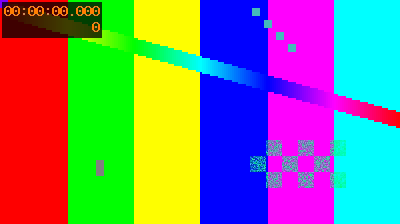

# Feature test deck

## Every part of the Markdown subset

Parsed and rendered by the Lean slideshow checks

Note: This line is a speaker note: logged, never drawn.

---

# Inline styles

Plain text, **bold text**, *italic text*, ***bold italic*** and `inline code`.

A literal \*asterisk\*, a lone * star, and snake_case_names stay as written.

A long paragraph wraps at spaces: the quick brown fox jumps over the lazy dog, then keeps running across the whole width of the screen until it needs a second line.

---

# Lists

- First level bullet with **bold**
  - Second level, a bit smaller
    - Third level
- A bullet whose text is long enough that it has to wrap onto a second line with a hanging indent
1. Numbered one
2. Numbered two with `code`
  - nested bullet under a number

---

# Code

```rust
fn main() {
    println!("hello, TV");	// a tab
}
```

Text after the code block.

---

# Image



---

# Thank you

Section slides are centred
